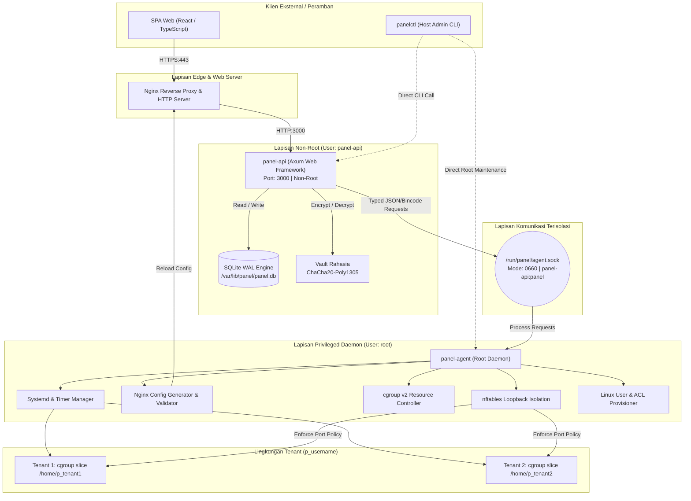

# Arsitektur Sistem Nusa Panel

Dokumen ini menyajikan spesifikasi arsitektur komprehensif dari Nusa Panel, mencakup model proses, pemisahan hak akses (*privilege separation*), protokol komunikasi antar-proses (IPC), model isolasi multi-tenant, dan strategi keandalan sistem.

---

## 1. Filosofi & Prinsip Desain

Nusa Panel dirancang dari awal untuk menjadi kontrol panel hosting server modern yang ringan, aman, dan dapat diandalkan:
1. **Pemisahan Hak Istimewa Ketat (*Strict Privilege Separation*)**: Layanan antarmuka web dan API publik tidak boleh berjalan dengan hak akses root.
2. **Protokol IPC Bertipe (*Strictly Typed IPC*)**: Daemon root tidak pernah menerima string perintah shell mentah atau path file arbitrer dari API.
3. **Jejak Memori Minimal (*Low Memory Footprint*)**: Target penggunaan RAM saat status siaga (*idle*) di bawah 65 MB dengan biner Rust native terkonsolidasi tanpa overhead runtime besar (seperti NodeJS daemon atau Python daemon).
4. **Operasi Idempoten & Transaksional**: Setiap perubahan konfigurasi sistem (Nginx, systemd, database) diterapkan secara atomik dengan mekanisme validasi dan pemulihan otomatis (*auto-rollback*).
5. **Observabilitas & Keandalan**: Menggunakan SQLite WAL dengan penguncian terkelola, auto-snapshot, serta pengawasan kesehatan berkala.

---

## 2. Diagram Komponen Sistem



---

## 3. Komponen Inti Nusa Panel

### 3.1 `panel-api` (API & Web Server)
- **Runtime**: Dibangun menggunakan Rust dan framework web asinkron `axum` serta runtime `tokio`.
- **Privilese**: Berjalan di bawah akun pengguna non-root `panel-api` dengan grup `panel`.
- **Fungsi Utama**:
  - Menyajikan API RESTful terstruktur dan OpenAPI schema (utoipa).
  - Menyajikan antarmuka frontend SPA statis.
  - Menangani otentikasi (Argon2id, JWT, sesi web, TOTP 2FA).
  - Otorisasi berbasis peran (RBAC: Admin, Operator, Tenant).
  - Mengelola basis data metadata aplikasi (SQLite).
  - Menyalurkan perintah manajemen sistem ke `panel-agent` via UNIX domain socket.
  - Streaming metrik sistem realtime via WebSocket & Server-Sent Events (SSE).
  - Menyediakan terminal interaktif via WebSocket xterm.js bridge terisolasi.

### 3.2 `panel-agent` (System Daemon Privileged)
- **Runtime**: Biner Rust native yang berjalan sebagai unit systemd `panel-agent.service` dengan hak akses root.
- **IPC Interface**: Hanya mendengarkan pada soket lokal UNIX Domain Socket di `/run/panel/agent.sock`. Izin berkas dikunci ke `0660` dengan pemilik `root:panel`.
- **Karakteristik Keamanan**:
  - **TIDAK ADA eksekusi shell bebas (`sh -c <string>`)**: Setiap perintah yang dieksekusi memiliki argumen terpisah via `std::process::Command`.
  - **Hanya Menerima Perintah Bertipe**: Permintaan diparsing ke dalam Rust `enum AgentRequest` yang didefinisikan secara statis.
  - **Validasi Path Ketat**: Semua path divalidasi tidak mengandung directory traversal (`..`) atau menembus ke direktori terlarang (`/etc`, `/boot`, `/root`).

### 3.3 `panel-core` (Shared Abstractions)
Pustaka pustaka bersama yang digunakan oleh seluruh modul:
- Abstraksi entitas domain (Site, Database, User, Plan, DnsRecord, CronJob).
- Modul Kriptografi: Dual-key ChaCha20-Poly1305 encryption, master key rotation, HKDF key derivation.
- System hardening logic: validasi parameter kernel, konfigurasi firewall nftables, integrasi PAM.
- Backup & restore engine: snapshot WAL database, arsip tar.zst terenkripsi.

### 3.4 `panelctl` (Administrative CLI)
Alat baris perintah khusus administrator host untuk operasi out-of-band:
- Diagnosa kesehatan instalasi (`panelctl doctor`).
- Bootstrap dan reset kredensial darurat (`panelctl reset-admin`).
- Manajemen backup dan pemulihan instan (`panelctl backup`, `panelctl restore`).
- Peningkatan versi atomik dan rollback otomatis (`panelctl upgrade`, `panelctl rollback`).
- Rekonsiliasi konfigurasi Nginx dan firewall (`panelctl reconcile`).

---

## 4. Protokol IPC (Inter-Process Communication)

Komunikasi antara `panel-api` dan `panel-agent` dilakukan secara asinkron menggunakan protokol IPC terstruktur.

### 4.1 Definisi Protokol Bertipe
Setiap pesan IPC dienkapsulasi dalam struktur data bertipe kuat:

```rust
#[derive(Serialize, Deserialize, Debug)]
#[serde(tag = "action", content = "payload")]
pub enum AgentRequest {
    UserCreate { username: String, uid: Option<u32>, shell: Option<String> },
    UserDelete { username: String, purge_home: bool },
    SiteApply { site: SiteConfiguration },
    SiteDelete { site_id: Uuid, vhost_name: String },
    SiteReloadNginx,
    DatabaseCreate { db_type: DatabaseType, name: String, owner: String },
    DatabaseDelete { db_type: DatabaseType, name: String },
    CgroupApply { username: String, limits: ResourceLimits },
    NftablesApplyRules { rules: Vec<FirewallRule> },
    BackupCreate { target: BackupTarget },
    SystemDoctorRun,
}
```

### 4.2 Format Respons
Respons dari daemon root selalu mencakup status terstandarisasi:

```rust
#[derive(Serialize, Deserialize, Debug)]
pub struct AgentResponse<T> {
    pub success: bool,
    pub data: Option<T>,
    pub error: Option<AgentErrorDetails>,
    pub execution_time_ms: u64,
}
```

Jika terjadi kesalahan di level sistem, daemon mengembalikan representasi kode error terstruktur (bukan string mentah stderr yang membocorkan path rahasia).

---

## 5. Model Isolasi Multi-Tenant

Nusa Panel mengimplementasikan isolasi berlapis (*defense-in-depth*) untuk memastikan satu tenant yang disusupi tidak dapat membahayakan tenant lain maupun host utama.

### 5.1 Isolasi Pengguna Linux & File System
1. **User Unik**: Setiap tenant dipetakan ke akun sistem POSIX unik dengan awalan `p_` (misalnya `p_budi`).
2. **UID / GID Mandiri**: UID dialokasikan pada rentang non-sistem (>= 1000).
3. **Izin Direktori Home**: Direktori `/home/p_<username>` diatur ke permission `0700` atau `0750`.
4. **POSIX ACLs untuk Web Server**: Akses worker Nginx ke direktori publik tenant diberikan secara eksplisit melalui POSIX ACL (`setfacl -m u:www-data:rx /home/p_<username>`), sehingga pengguna Linux lain tetap tidak memiliki izin baca/tulis.
5. **Visibilitas Proses (`hidepid=2`)**: File system `/proc` dipasang (*mount*) dengan parameter `hidepid=2,gid=panel`. Pengguna tenant hanya dapat melihat proses milik dirinya sendiri di `ps` atau `top`.

### 5.2 Pembatasan Sumber Daya (cgroup v2)
Setiap akun tenant ditempatkan di dalam slice cgroup v2 tersendiri di bawah pohon hierarki `/sys/fs/cgroup/panel.slice/tenant-<username>.slice`:
- **`cpu.max`**: Membatasi kuota persentase CPU (misal `200000 100000` = maksimal 2 CPU core).
- **`memory.high` & `memory.max`**: Menetapkan batas throttling agresif dan batas keras alokasi memori fisik untuk mencegah OOM (*Out Of Memory*) pada server.
- **`io.weight` & `io.max`**: Mengatur prioritas baca/tulis disk I/O agar tidak terjadi disk starvation.
- **`pids.max`**: Membatasi jumlah proses/thread maksimal untuk menangkis serangan *fork bomb*.

### 5.3 Isolasi Jaringan Loopback (nftables)
Secara tradisional, aplikasi pada shared hosting dapat saling mengakses port internal lokal (`127.0.0.1:8080`, dll). Nusa Panel mencegah hal ini menggunakan aturan kernel `nftables`:
- Aturan `meta skuid p_<tenant>` mencegah proses tenant melakukan *bind* ke port sistem atau port reservasi panel.
- Pembatasan koneksi lokal antar-UID: Paket loopback dari UID tenant A ditolak jika mencoba menjangkau port yang dibuka oleh UID tenant B.
- Layanan database lokal (MariaDB:3306, PostgreSQL:5432) hanya dapat diakses melalui soket UNIX domain terotentikasi atau koneksi TCP yang divalidasi.

---

## 6. Mesin Konfigurasi Nginx Atomik

Untuk mencegah kerusakan konfigurasi global yang dapat meruntuhkan seluruh situs di server (*crash all sites*), Nusa Panel menggunakan siklus modifikasi 4 langkah atomik:

```
[ Generate ke Direktori Staging ]
(/etc/panel/nginx/staging/site-example.conf)
                │
                ▼
[ Uji Validitas Konfigurasi Nginx ]
(nginx -t -c /etc/panel/nginx/staging.conf)
                │
        ┌───────┴───────┐
   Lulus Validasi     Gagal Validasi
        │               │
        ▼               ▼
[ Rename Atomik & Symlink ]    [ Bersihkan Staging & Rollback ]
(/etc/panel/nginx/sites-available)   (Kembalikan error jelas ke API)
                │
                ▼
[ Systemctl Reload Nginx ]
```

1. **Staging**: File konfigurasi virtual host baru ditulis ke direktori staging terisolasi.
2. **Validasi**: Perintah `nginx -t` dijalankan pada konfigurasi staging.
3. **Penerapan Atomik**: Jika validasi berhasil, file dipindahkan (*atomic rename*) ke `/etc/panel/nginx/sites-available/` dan di-symlink ke `/etc/panel/nginx/sites-enabled/`.
4. **Reload Non-Disruptive**: Menjalankan `systemctl reload nginx` tanpa memutus koneksi klien yang sedang aktif (*zero-downtime graceful reload*).

---

## 7. Penyimpanan Data & SQLite WAL

Nusa Panel menggunakan mesin basis data embedded SQLite dengan konfigurasi optimal untuk beban produksi:
- **Write-Ahead Logging (WAL)**: `PRAGMA journal_mode = WAL;` memungkinkan pembacaan (*concurrent reads*) berjalan bersamaan tanpa terblokir oleh operasi penulisan.
- **Sinkronisasi Terukur**: `PRAGMA synchronous = NORMAL;` menjamin integritas data saat crash sistem tanpa overhead penulisan disk berlebih.
- **Busy Timeout**: `PRAGMA busy_timeout = 5000;` mencegah galat `database is locked` saat terjadi lonjakan konkurensi.
- **Foreign Keys**: `PRAGMA foreign_keys = ON;` memastikan konsistensi relasional data.
- **Online Backup API**: Pencadangan snapshot database dilakukan menggunakan API SQLite Backup native sehingga tidak memerlukan penghentian layanan (*zero-lock backup*).
